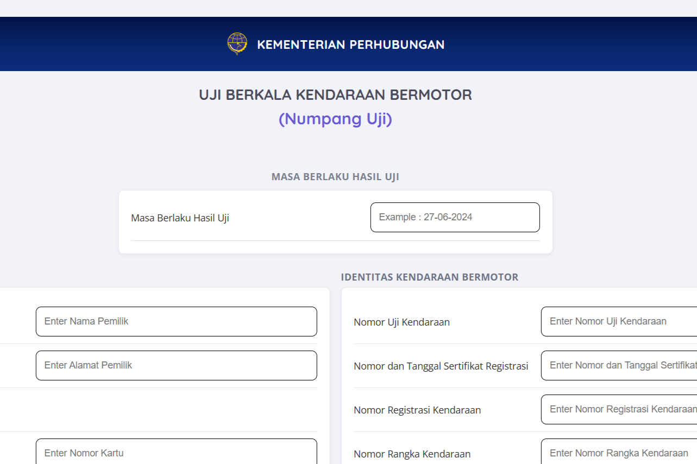

# Dishub Uji Berkala

Periodic vehicle inspection records application with a dashboard, inspection forms, and file management.

**Status:** Local development; a public demo is not yet available.

## Preview

[](docs/screenshots/project-preview.png)

## Features

- Staff authentication and dashboard
- Inspection result and validity period records
- Vehicle document uploads and result displays

## Technology

PHP, MySQL, HTML, CSS, JavaScript.

## Running Locally

Use an Apache/PHP server, such as XAMPP. Place a copy of the project in the document root and open `login.php` through localhost. Any `.htaccess` rules require an appropriately configured Apache server.

## Database

Ready-to-import SQL is available at [`database/dishub.sql`](database/dishub.sql). This file comes from a sanitized project dump: table structures, indexes, and relationships are preserved; accounts, password hashes, personal data, and original operational data are excluded.

1. Create an empty database named `dishub` using phpMyAdmin.
2. Select the database, open the **Import** tab, and choose `database/dishub.sql`. The SQL is intended for an empty database and does not delete existing tables.
3. Copy the configuration template listed in the table below, then enter your local MySQL host, database name `dishub`, username, and password in `config.php`.
4. From the project directory, run `php database/create-admin.php` to create a local account with a password of your choice. The repository does not include default accounts or passwords.

Alternatively, import through the MySQL terminal after creating an empty database:

```sql
USE dishub;
SOURCE database/dishub.sql;
```

Run the `SOURCE` command from the project directory. On XAMPP for Windows, the PHP CLI is available at `C:\xampp\php\php.exe`.


The `save_uji.php` endpoint uses the `DB_DSN`, `DB_USERNAME`, and `DB_PASSWORD` server environment variables. Set `DB_DSN` to the MySQL DSN for the same development database configured in `config.php`.

## Private Configuration

Copy the following templates to their corresponding local filenames, then enter the values for your environment:

| Template | Local File |
| --- | --- |
| `config.example.php` | `config.php` |

Local configuration files are ignored by Git. Do not include passwords, API keys, or account data in the source code.

## Repository Notes

Installed dependencies, caches, `.env` files, operational database data, and user uploads are not included. Brand names and third-party assets remain subject to their respective owners' rights. This repository does not grant a license for reuse.
